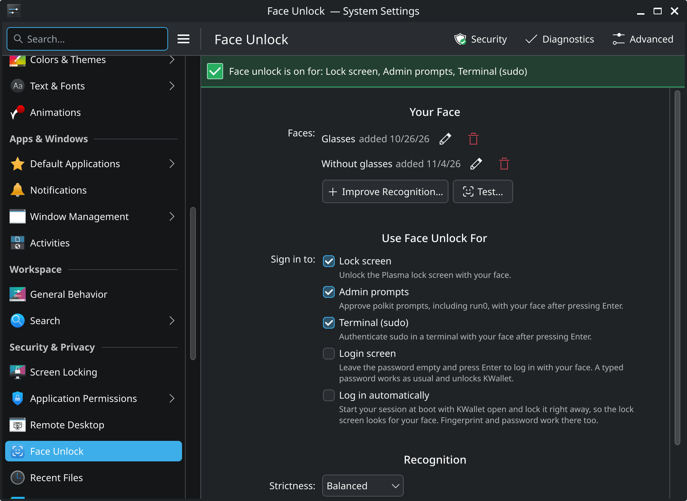

# Linux Hello



Face unlock for KDE Plasma and GNOME, sudo and polkit.

- Unlocks the lock screen, approves polkit prompts and sudo with your face.
- Admin prompts and sudo scan only after you press Enter, so other programs can't use your face.
- Can log you in at boot with your keyring (KWallet, GNOME Keyring) open and lock the screen at once, so you only look at the camera. Works with the Plasma login manager, SDDM and GDM.
- Prefers the infrared camera and switches its IR light on by itself.
- Set up in System Settings on Plasma or the Face Unlock app on GNOME. No terminal, no config files.
- Your password always keeps working.

## Requirements

- KDE Plasma 6 or GNOME 46 or later, on Wayland. Face unlock on the Plasma
  lock screen needs Plasma 6.8 or later; on the GNOME lock screen it needs the
  Linux Hello extension for GNOME Shell, which comes with the GNOME package.
  X11 is not supported: any program there can read your keys.
- A camera. An infrared (Windows Hello) camera works in the dark and is much
  harder to fool.

## Install

There are no release packages yet. Build them from this repository:

```sh
# Arch, CachyOS: linux-hello-git, plus linux-hello-kde-git or linux-hello-gnome-git
cd packaging/arch && makepkg -si
```

Fedora (`packaging/fedora/linux-hello.spec`) and Debian/Ubuntu (`debian/`)
packages build the same way; see `.github/workflows/check.yml` for the steps.
Each build gives a core package with the service, PAM module and command line
tool, a `-kde` package with the System Settings page and a `-gnome` package
with the Face Unlock app and the GNOME Shell extension.

Switching from a source install to a package? Run
`sudo tools/uninstall.sh` first: files a source install left behind are
unknown to pacman and stop the install with a file conflict.

Then open **System Settings > Security & Privacy > Face Unlock** on Plasma, or
the **Face Unlock** app on GNOME.

## Uninstall

Remove the package. Linux Hello undoes its PAM changes before it goes. Face
models stay in `/var/lib/linux-hello` until you delete them.

## Command line

```sh
linux-hello-cli status        # what is set up
linux-hello-cli add           # add your face
linux-hello-cli enable sudo   # lock-screen, admin, sudo, login, auto-login
linux-hello-cli doctor        # find problems
```

## Build from source

Needs a C++20 compiler, `meson`, `ninja` and the headers for `pam`,
`libevdev`, `libsystemd` and `inih`. The System Settings page also needs
`cmake`, `extra-cmake-modules`, Qt 6 and KDE Frameworks 6 (KCMUtils, Kirigami,
I18n, Config, CoreAddons). The GNOME parts are JavaScript and need `gjs` and
`libadwaita` at run time.

```sh
tools/build_runtime.sh --outdir build-runtime
meson setup build -Dbundled_python_dir="$PWD/build-runtime/linux-hello-runtime"
ninja -C build && sudo ninja -C build install

cmake -B build-kcm -S kcm -DCMAKE_INSTALL_PREFIX=/usr
cmake --build build-kcm && sudo cmake --install build-kcm
```

`build_runtime.sh` downloads a Python runtime with OpenCV and dlib, pinned in
`tools/runtime-manifest.json`. Without `-Dbundled_python_dir`, the system Python
is used and needs OpenCV, dlib, numpy and dbus-fast. `-Dwith_gnome=false`
leaves out the GNOME Shell extension and the Face Unlock app; the `cmake` steps
are only for Plasma.

Remove a source install with `sudo tools/uninstall.sh`.

## Hardware notes

- **IR light stays off**: run `sudo linux-hello-cli emitter search`.
- **ASUS laptops with Sonix IR cameras (`3277:0018`)**: the IR light follows
  the proximity sensor. Do not run `emitter search` or
  `linux-enable-ir-emitter` on these; it can hang the USB bus
  (boltgolt/howdy#1109).
- **SELinux (Fedora)**: if the camera fails, check the audit log for
  `linux-hello-daemon`.
- **Keyboard remappers** (keyd, kanata, Steam Input): the Enter for sudo and
  admin prompts is not seen, so those fall back to your password.

## Security

See [SECURITY.md](SECURITY.md) for what Linux Hello protects against and how
to report a vulnerability.

Full support needs an encrypted disk: logging in automatically keeps your
password to open your keyring, and without encryption anyone with your computer can
read it and your files from a USB stick. [Encrypt your disk](docs/disk-encryption.md)
with LUKS, and add the TPM and Secure Boot to boot without typing anything.

## Credits

Remake of [Howdy](https://github.com/boltgolt/howdy) by boltgolt, MIT licensed;
see [NOTICE](NOTICE). Includes
[#1088](https://github.com/boltgolt/howdy/pull/1088) by haleelrah (recognition
backends) and [#1125](https://github.com/boltgolt/howdy/pull/1125) by qilsklo
(WebAuthn). IR light control follows
[linux-enable-ir-emitter](https://github.com/EmixamPP/linux-enable-ir-emitter).

## License

GPL-3.0. See [LICENSE](LICENSE) and [NOTICE](NOTICE).
